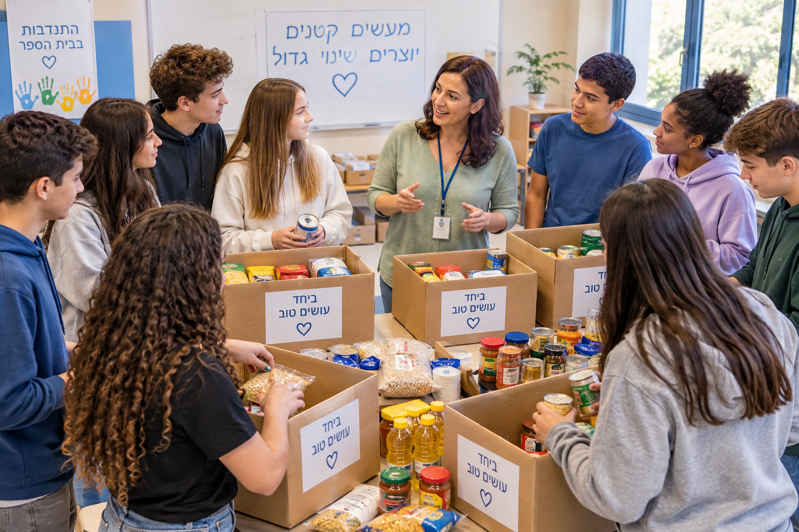

# שקף 3

**תבנית:** HookClosingText

## הנחיות הפקה (מתוך הערות השקף)

- שם המסך בפיגמה: HookClosingText
- תמונה: הוק ארגזי מזון 1.6

## תוכן השקף

- כמו בכל שנה לקראת החגים, היום בבוקר מתקיים מבצע התנדבות בבית הספר:
- אריזת ארגזי מזון לקשישות וקשישים בקהילה.
- לימור רכזת השכבה מסבירה לכם כלל חשוב:
- "בכל ארגז נשים שימורים ומוצרים יבשים ביחס קבוע של 3:4 כדי שכל הארגזים יהיו שווים, וכל מבוגרת ומבוגר יקבלו אותה כמות בדיוק."
- חזרה
- המשך

## תמונות רפרנס

