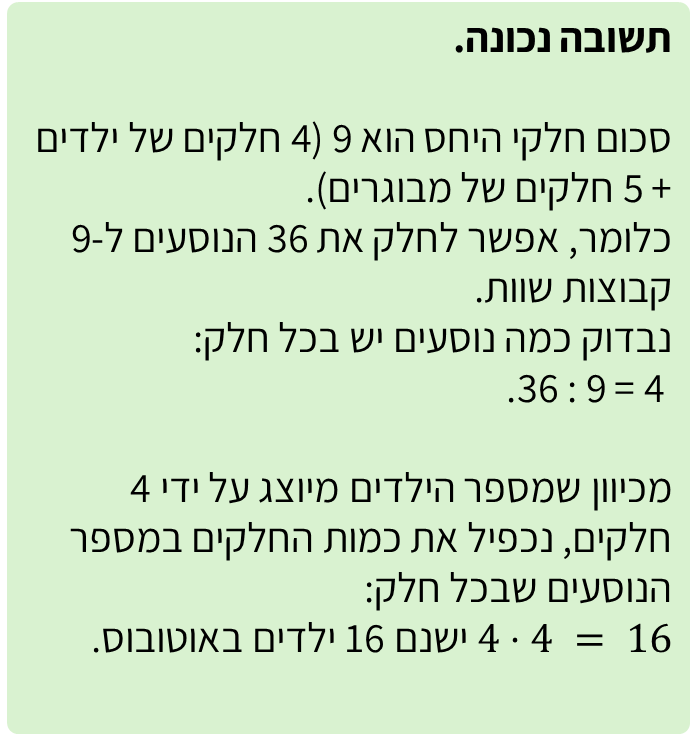
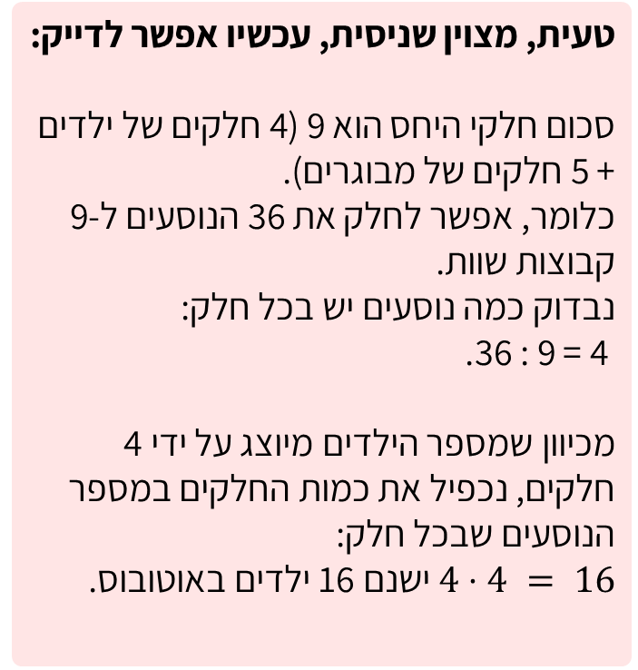
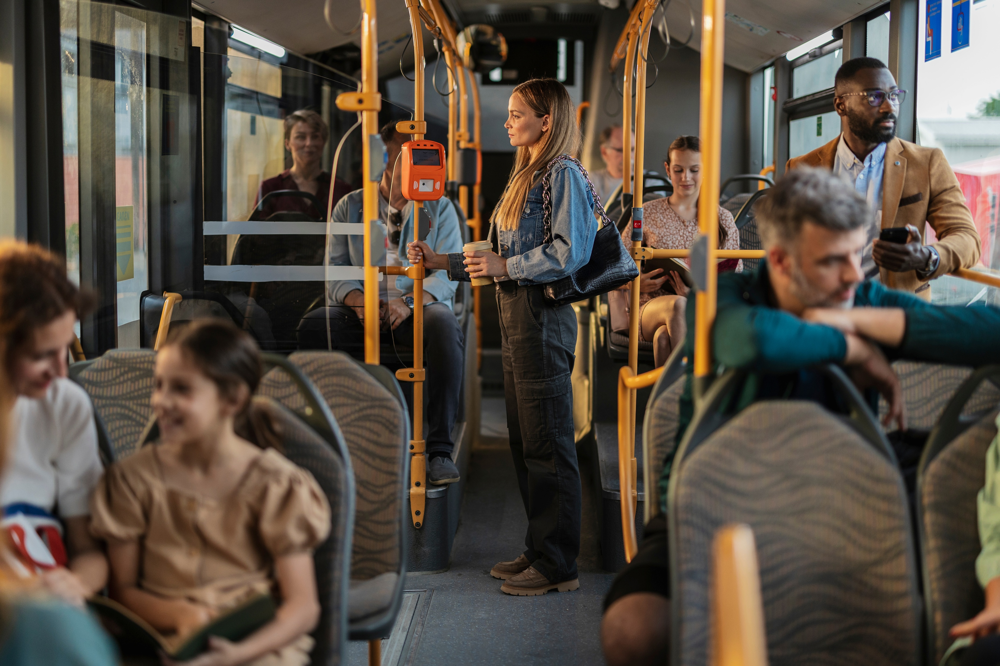

# שקף 8

**תבנית:** MultipleChoiceQuestion

## הנחיות הפקה (מתוך הערות השקף)

- שם המסך בפיגמה: MultipleChoiceQuestion
- תמונה: אוטובוס שאלה 1
- שאלה 1 מתוך 10
- שימו לב שצריך להתאים את הבר למעלה ל 10 שאלות.
- שים לב - הרמז בכל היחידה הזו מגיע אחרי טעות אחת.

## תוכן השקף

- צדקתי?
- באוטובוס ישנם 36 ילדים ומבוגרים.
- היחס בין מספר הילדים למבוגרים על האוטובוס הוא 4:5.
- כמה ילדים באוטובוס?
- 4
- אפשר רמז?
- חזרה
- תשובה נכונה.
- סכום חלקי היחס הוא 9 (4 חלקים של ילדים + 5 חלקים של מבוגרים).
- כלומר, אפשר לחלק את 36 הנוסעים ל-9 קבוצות שוות.
- נבדוק כמה נוסעים יש בכל חלק:
- 4 = 9 : 36.
- מכיוון שמספר הילדים מיוצג על ידי 4 חלקים, נכפיל את כמות החלקים במספר הנוסעים שבכל חלק: ישנם 16 ילדים באוטובוס.
- היחס  4:5 משמעו שהנוסעים מחולקים לקבוצות שוות.
- כמה "חלקים" (או "מנות") יש בסך הכל באוטובוס.
- כמה מתוכם מייצגים את הילדים?
- חזרה לשאלה
- 8
- 16
- 20
- טעית, מצוין שניסית, עכשיו אפשר לדייק:
- סכום חלקי היחס הוא 9 (4 חלקים של ילדים + 5 חלקים של מבוגרים).
- כלומר, אפשר לחלק את 36 הנוסעים ל-9 קבוצות שוות.
- נבדוק כמה נוסעים יש בכל חלק:
- 4 = 9 : 36.
- מכיוון שמספר הילדים מיוצג על ידי 4 חלקים, נכפיל את כמות החלקים במספר הנוסעים שבכל חלק: ישנם 16 ילדים באוטובוס.

## תמונות רפרנס

