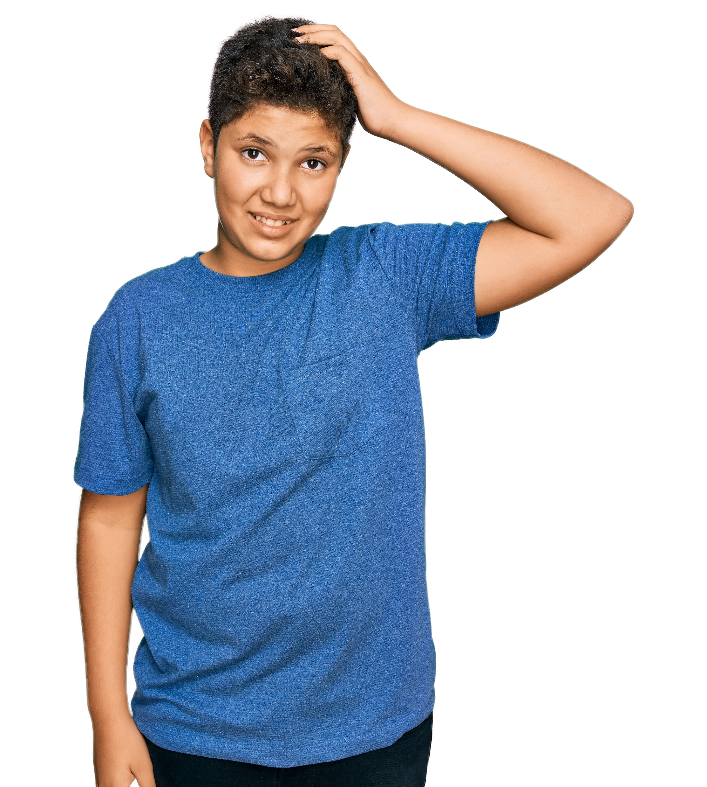

# שקף 14

**תבנית:** SingleChoiceQuestionImage

## הנחיות הפקה (מתוך הערות השקף)

- שם המסך בפיגמה:SingleChoiceQuestionImage
- שאלה 7 מתוך 10
- תמונה: ניר שאלה 7
- להתאים את התיבות של המסיחים לאורך התיבה הארוך ביותר.

## תוכן השקף

- צדקתי?
- 1.2
- 2.4
- 1.5
- 2
- אפשר רמז?
- חזרה
- נכון!
- במתכון המקורי היחס הוא 2 ביצים ל-0.6 ליטר חלב. לניר 5 ביצים, כלומר פי 2.5 מהכמות המקורית.
- נכפול את המספר 0.6 ליטר חלב ב-2.5 ונקבל 1.5 ליטר חלב.
- התשובה הנכונה היא 1.5 ליטר.
- חשבו כמה חלב דרוש כדי להכין עוגה עם ביצה אחת בלבד, או מצאו פי כמה גדולה כמות הביצים החדשה לעומת הכמות במתכון המקורי.
- חזרה לשאלה
- טעית, לא נורא, הנה ההסבר:
- במתכון המקורי היחס הוא 2 ביצים ל-0.6 ליטר חלב. לניר 5 ביצים, כלומר פי 2.5 מהכמות המקורית.
- נכפול את המספר 0.6 ליטר חלב ב-2.5 ונקבל 1.5 ליטר חלב.
- התשובה הנכונה היא 1.5 ליטר.
- לניר יש מתכון לעוגה שצריכה 2 ביצים ו-0.6 ליטר חלב.
- הוא רוצה להכין עוגה גדולה ככל האפשר ויש לו רק 5 ביצים.
- כמה ליטר חלב ניר צריך כדי להכין את העוגה הגדולה ביותר שאפשר?

## תמונות רפרנס

